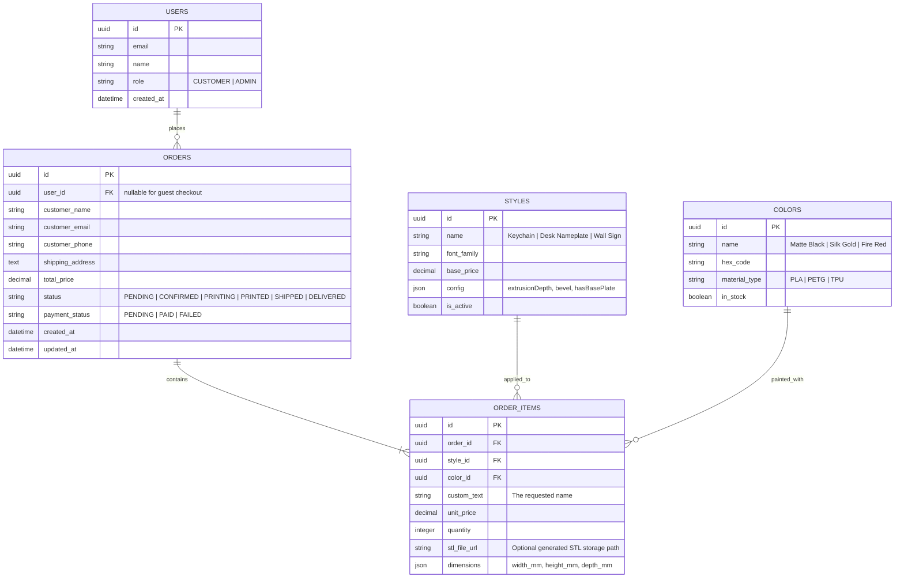

# PrintX3D — System Architecture & Project Blueprint

## 1. Project Overview

**PrintX3D** is an on-demand customized 3D printing platform. The web application allows customers to:
1. Input their custom text (e.g., their name).
2. Choose a typographic/3D style (font, base plate, stand, keychain loop, dimensions).
3. Select filament colors and materials (PLA, PETG, etc.).
4. Inspect a real-time interactive 3D preview in the browser.
5. Place an order with shipping details and payment.
6. Enable the maker/admin to view orders, download 3D specs/files, track print queues, and manage fulfillment.

---

## 2. Technology Stack

| Layer | Technology | Purpose |
| :--- | :--- | :--- |
| **Runtime & Language** | Node.js (v20+) & TypeScript | Full end-to-end type safety |
| **Framework** | Next.js (App Router) *or* Express + React | Full-stack web framework & API routing |
| **Styling** | Tailwind CSS | Responsive, utility-first UI styling |
| **Database** | PostgreSQL | Relational storage for users, styles, inventory & orders |
| **ORM / Query Builder** | Prisma ORM *or* Drizzle ORM | Schema migrations and type-safe database queries |
| **3D Rendering** | Three.js / React Three Fiber (`@react-three/fiber`, `@react-three/drei`) | Client-side real-time 3D text extrusion and material preview |
| **Validation** | Zod | Runtime request/form validation |
| **Authentication** | NextAuth.js / Lucide Auth / JWT | Customer authentication and Admin role enforcement |

---

## 3. Directory & Folder Layout

```text
printx3d/
├── .env.example                     # Environment variable blueprint
├── package.json
├── tsconfig.json
├── tailwind.config.ts
├── postcss.config.js
├── prisma/                          # Database schema & migrations
│   ├── schema.prisma
│   └── seed.ts                      # Initial styles and color presets
├── src/
│   ├── app/                         # Next.js App Router
│   │   ├── (store)/                 # Customer-facing routes
│   │   │   ├── page.tsx             # Landing & Customizer Studio
│   │   │   ├── checkout/
│   │   │   │   └── page.tsx         # Order checkout
│   │   │   └── track/
│   │   │       └── [orderId]/       # Order tracking page
│   │   ├── admin/                   # Admin dashboard routes
│   │   │   ├── page.tsx             # Orders queue & print status
│   │   │   └── inventory/           # Filament colors & pricing management
│   │   └── api/                     # REST / Server Actions
│   │       ├── customizer/
│   │       │   └── fonts/route.ts   # Available styles and fonts
│   │       ├── orders/
│   │       │   ├── route.ts         # Create & list orders
│   │       │   └── [id]/route.ts    # Order status update
│   │       └── webhooks/route.ts    # Payment gateway webhook
│   ├── components/
│   │   ├── 3d/                      # Three.js / R3F Canvas components
│   │   │   ├── StudioCanvas.tsx     # 3D viewport & lighting
│   │   │   ├── TextMesh.tsx         # Extruded 3D name model
│   │   │   └── FilamentMaterial.tsx # Shader/Material mapping for colors
│   │   ├── customizer/              # UI Controls
│   │   │   ├── TextInput.tsx        # Name input field
│   │   │   ├── StyleSelector.tsx    # Font & stand selector
│   │   │   ├── ColorPicker.tsx      # Filament color swatch picker
│   │   │   └── PriceSummary.tsx     # Dynamic price calculator
│   │   ├── admin/                   # Admin queue components
│   │   └── ui/                      # Reusable components (Buttons, Modals, Cards)
│   ├── lib/
│   │   ├── db.ts                    # Database client instance (Prisma/Drizzle)
│   │   ├── 3d-generator.ts          # STL/Mesh generation helpers
│   │   └── utils.ts                 # Formatting & helpers
│   ├── types/                       # Shared TypeScript interfaces & types
│   │   ├── index.ts
│   │   └── order.ts
│   └── styles/
│       └── globals.css
└── public/
    ├── fonts/                       # 3D typeface files (Typeface.json for Three.js)
    └── models/                      # Preset baseplates, stands, or keychain loops
```

---

## 4. PostgreSQL Database Schema

### Entity Relationship Model



---

## 5. Core Application Workflows

### 5.1 Customizer & 3D Preview Flow
1. User enters text in the client UI.
2. Three.js `FontLoader` loads a vector `typeface.json` font.
3. `TextGeometry` extrudes the name into a 3D mesh with specified bevels, height, and depth.
4. User selects a color: `MeshStandardMaterial` updates roughness, metalness, and hex color dynamically.
5. User selects an attachment style (e.g., Base Stand, Keychain Ring, Flat Magnet).

### 5.2 Order Submission Flow
1. Client submits:
   - `customText`
   - `styleId`
   - `colorId`
   - `customerDetails` (Name, Phone, Delivery Address)
2. API validates data via Zod.
3. Order is recorded in PostgreSQL with status `PENDING`.
4. Payment is verified (or Cash on Delivery / Bank Transfer recorded).
5. Maker receives an alert on the Admin Dashboard.

### 5.3 Maker / Admin Fulfillment Flow
1. Admin logs into `/admin`.
2. Inspects order queue sorted by date and priority.
3. Clicks **Export Model Specs / STL** for the chosen text and dimensions.
4. Maker slices the file in their 3D slicer (Bambu Studio, PrusaSlicer, Cura).
5. Updates status: `CONFIRMED` &rarr; `PRINTING` &rarr; `PRINTED` &rarr; `SHIPPED`.
6. Automated status email or tracking link updates the customer.

---

## 6. Guidelines for Antigravity AI Assistants

When assisting in the development of this repository:
1. **Type Safety:** Always declare strict TypeScript interfaces for API payloads, database models, and 3D parameters.
2. **Performance:** Do not re-create 3D fonts or geometries on every render loop; memoize geometries with `useMemo` in React/Three.js.
3. **Database Integrity:** Handle decimal money amounts appropriately and write migrations inside `prisma/migrations/`.
4. **Modularity:** Keep 3D Canvas logic in `src/components/3d` and business/order forms in `src/components/customizer`.
